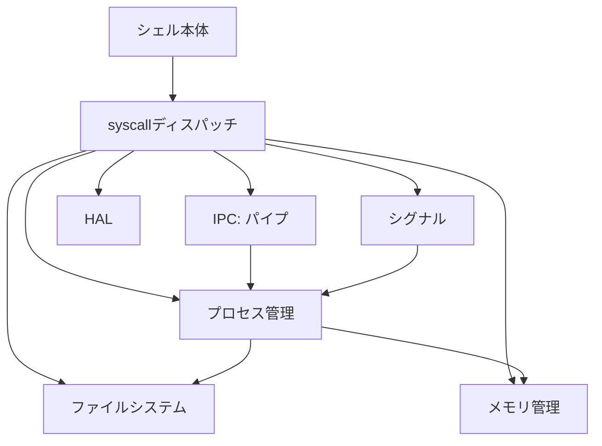

# Ancient UNIX風 サブセットOS 全体仕様書

**位置づけ**: 本書は個人によるサンデープロジェクトとして開発する「Ancient UNIX風 サブセットOS」の全体概要をまとめたものである。目標水準は「ash (Almquist Shell)がそれっぽく動く」こと。ファイルシステム、プロセス管理などサブシステムごとの詳細仕様は別文書とし、本書では以下の4点に絞って記述する。

1. システムコールの一覧と分類
2. サブシステムの分割
3. システムコールリファレンス(機能・引数・戻り値)
4. 実装計画(順序とマイルストーン)

> **注意事項**： 本OSはAT&T ベル研究所で1970年代に開発された歴史的なUNIX（V7までの、いわゆる Ancient UNIX）の挙動や仕様を参考に、完全にゼロからスクラッチ開発する互換ソフトウェアである。公開されたものも含めUNIXのソースコードを一切使用してはならない。

> **他社商標について**: UNIXは米国およびその他の国における The Open Group の登録商標である。

## 開発方針と想定ハードウェア

実装の初期段階ではハードウェアと切り離して開発を進めるが（4.1節参照）、最終的にはRaspberry Pi Pico (Cortex-M0 CPU)をターゲットとする。また「32bitかつMMUなし」という共通点のあるMC68000 CPUもターゲットに含める。

必要メモリは2MB未満、ソースコード6000行以下を目安にする。

他のOSと比較した違いを下記に示す。

- BSD、Linux : 本OSはMMUを必要としない。
- uClinux (Linux NOMMU) : 本OSは遥かに小規模である。
- xv6 : 本OSはV7の仕様を参考にしており、現代のPOSIXにより近い。
- MINIX V2、ELKS、FUZIX : 本OSは32bitネイティブで開発されている。また、より新しいC/C++規格を前提にしている。

## 設計思想と参考OS

本OSが目標とするのは、UNIX V7を一つの基準とした外部機能の水準であり、V7のカーネル内部構造や実装方式の再現ではない。必要な機能を選択的に実装し、V7とのバイナリ互換性や完全なAPI互換性は目標としない。現代のプログラムの移植性も考慮する。

カーネルはモノリシック構成とする。内部のアーキテクチャ、データ構造、アルゴリズム、サブシステム間のインターフェースは、V7の実装に拘束されない。4.3BSD、386BSD、FreeBSD、NetBSD、Linux、xv6などのUNIX系OSに加え、MMUなし・小規模環境の参考としてFUZIXやuClinuxなども、目的に応じて参照してよい。これらは候補の例示であり、参照先を限定したり、特定のOSの方式を優先したりするものではなく、ベストなものを柔軟に参照すること。例えば、本OSのファイルシステムのアロケーションはMS-DOSのFATテーブルを参考にしている。

設計の採否は、対象ハードウェアの制約、実装規模、単純さ、保守性、移植性によって判断する。参考OSの設計を無条件に移植せず、必要な要素のみ採用する。歴史的な実装方式への忠実性は評価基準としない。UNIXのソースコードを流用しないという本書の制約は、後世のOSの設計思想や公開資料を参考にすることまで禁じるものではない。

---

## 1. システムコールの一覧と分類

### 1.1 UNIX V7 の全システムコール(参考・母集団)


V7 の `sysent.c` に定義された64個のシステムコールを分類した。うち12個は未実装や廃止，予約番号で、残り52個が有意なシステムコールとなる。
( https://www.tuhs.org/cgi-bin/utree.pl?file=V7/usr/sys/sys/sysent.c より)

| カテゴリ | システムコール | 個数 |
| --- | --- | --- |
| プロセス制御 | `exit`, `fork`, `exec`, `brk`(`break`), `getpid`, `ptrace`, `alarm`, `pause`, `nice`, `kill`, `wait`, `signal`, `exece` | 13 |
| ファイル・ディレクトリ | `read`, `write`, `open`, `close`, `creat`, `link`, `unlink`, `chdir`, `mknod`, `chmod`, `chown`, `stat`, `seek`, `mount`, `umount`, `fstat`, `utime`, `access`, `sync`, `dup`, `pipe`, `umask`, `chroot` | 23 |
| ユーザー/グループID | `setuid`, `getuid`, `setgid`, `getgid` | 4 |
| 時刻 | `time`, `stime`, `ftime`, `times` | 4 |
| 端末・デバイス | `stty`, `gtty`, `ioctl` | 3 |
| その他 | `profil`, `acct`, `phys`, `lock`, `mpx` | 5 |
| 未実装・廃止・予約番号 | 未実装(`setpgr`), 廃止(`indir`, `switch`, `tell`), 予約番号(45番, 49番, 50番, 55番, 57番, 58番, 62番, 63番) | 12 |
| 合計 | | 64 |

> `break`はlibcでは`brk`/`sbrk`となっていること、後の時代のBSDやLinuxではシステムコールも`brk`となることから、本書では`brk`として扱う。

さらに参考として、UNIX V6を再実装したOSであるxv6の全システムコールも以下に示す。

| カテゴリ | システムコール | 個数 |
| --- | --- | --- |
| プロセス制御 | `exit`, `fork`, `exec`, **`sbrk`**, `getpid`, `kill`, `wait`, **`sleep`** | 8 |
| ファイルI/O | `read`, `write`, `open`, `close`, `link`, `unlink`, `chdir`, `mknod`, `fstat`, `dup`, `pipe`, **`mkdir`** | 12 |
| ユーザー/グループID | (なし) | |
| 時刻 | (なし) | |
| 端末・デバイス | (なし) | |
| 合計 | | 20 |

> `sleep`と`mkdir`がV7には存在しない。`sbrk`はV7の`break`が同様の機能を担う。

### 1.2 サブセットOSにおける必要性分類

シングルユーザー・単一ファイルシステムという前提の下、「ashがそれっぽく動く」ことを基準に、必要度を4段階(Lv.0〜Lv.2、および対象外)で分類する。

#### Lv.0a: コマンドディスパッチャ(プロンプト表示・実行のみ)

`echo foo` 程度が動く。`cat file > out` も `cmd1 | cmd2` もできない段階。ディレクトリは存在するが、操作ができない。

| カテゴリ | システムコール | 個数 |
| --- | --- | --- |
| プロセス制御 | `exit`, **`spawn`**, `wait` | 3 |
| ファイル・ディレクトリ | `read`, `write`, `open`, `close`, `stat` | 5 |
| その他 | **`putstrk`** | 1 |
| 合計 | | 9 |

> **`spawn`** と **`putstrk`** はV7に存在しないシステムコール。
> **`spawn`**: `fork`+`exec`相当を一気に行う。MMUが無くとも実装可能。
> **`putstrk`**: デバッグ用に標準入出力機構をバイパスしてメッセージを出力する。Linuxの`printk`と異なり、単純な文字列出力に特化し書式指定を行わない。

用途別で分類すると以下の通り。

| 用途 | システムコール |
| --- | --- |
| プロセス生成/実行/終了/待機 | `spawn`, `exit`, `wait` |
| コマンド探索(PATH) | `stat` |
| 標準入出力 | `read`, `write`, `open`, `close` |
| カーネルデバッグ用 | `putstrk` |

#### Lv.0b: コマンドディスパッチャ(ディレクトリ操作)

Lv.0a に以下を追加。

`ls`とディレクトリ操作`mkdir`、`rmdir`が動く。

| カテゴリ | システムコール | 個数 |
| --- | --- | --- |
| ファイル・ディレクトリ | `unlink`, `chdir`, **`mkdir`**, **`rmdir`**, **`getdents`** | 5 |
| 合計 | | 5 |
| 累計 | | 14 |

> ディレクトリ関係の`mkdir`、`rmdir`、`getdents`はV7に存在しないシステムコール。
> **`mkdir`**: ディレクトリを作成する。
> **`rmdir`**: ディレクトリを削除する。
> **`getdents`**: ディレクトリエントリを読みだす。

用途別で分類すると以下の通り。

| 用途 | システムコール |
| --- | --- |
| ファイル一覧(`ls`) | `getdents`, `chdir` |
| ファイル削除(`rm`) | `unlink` |
| ディレクトリ作成・削除 | `mkdir`, `rmdir` |

#### Lv.1a: ファイル操作(リダイレクトあり)

マルチタスク処理が不要な範囲で、シェルが使える。`cat file >> out`が動く。
内部的には子プロセスを起動した段階で親プロセスが待ちになって良い。(プリエンプトする必要がない)

Lv.0b に以下を追加。

| カテゴリ | システムコール | 個数 |
| --- | --- | --- |
| プロセス制御 | `getpid` | 1 |
| ファイル・ディレクトリ | **`creat`**, **`lseek`**, `dup` | 3 |
| 合計 | | 4 |
| 累計 | | 18 |

> **`creat`**: `open`の`O_CREAT`も同時に実装する。
> **`lseek`**:  V7では16bitオフセットの`seek`だが、64KB以上のファイルを扱えるように32bitオフセットの`lseek`とする。

用途別で分類すると以下の通り。

| 用途 | システムコール |
| --- | --- |
| `>` `>>` によるファイル作成 | `creat` |
| `2>&1` 等のfd付け替え | `dup` |
| ヒアドキュメント`<<`用一時ファイル | `getpid` |
| 複数回読み・巻き戻し | `lseek` |

#### Lv.1b: 実用最低ライン(パイプ・マルチタスクあり)

「シェルスクリプトが動く」と言える水準。`cmd1 | cmd2`が動く。
内部的はプリエンプティブマルチタスクになる。

Lv.1a に以下を追加。

| カテゴリ | システムコール | 個数 |
| --- | --- | --- |
| プロセス制御 | **`sleep`** | 1 |
| ファイル・ディレクトリ | `pipe` | 1 |
| 合計 | | 2 |
| 累計 | | 20 |

> `sleep`はV7に存在しないシステムコール。
> **`sleep`**: 他のプロセスに優先権を渡し、呼び出したプロセスは指定時間の間、実行を停止する。

用途別で分類すると以下の通り。

| 用途 | システムコール |
| --- | --- |
| `\|` パイプライン | `pipe` |
| 明示的なプロセス切り替え | `sleep` |

#### Lv.2: 実用に耐える水準(Ctrl-C, `trap`, `kill` が機能)

`kill`ができる。本プロジェクトの最終目標水準。

Lv.1b に以下を追加。

| カテゴリ | システムコール | 個数 |
| --- | --- | --- |
| プロセス制御 | `kill`, `signal` | 2 |
| 時間計測 | `times` | 1 |
| 合計 | | 3 |
| 累計 | | 23 |

用途別で分類すると以下の通り。

| 用途 | システムコール |
| --- | --- |
| SIGINT処理・`trap` | `signal` |
| `kill`ビルトイン | `kill` |
| 時間計測 | `times` |

#### 対象外(実装しない、または固定値スタブで済ませる)

V7のシステムコールのうち、以下を実装していない。

| カテゴリ | システムコール | 個数 |
| --- | --- | --- |
| プロセス制御 | `fork`, `exec`, `brk`(`break`), `ptrace`, `alarm`, `pause`, `nice`, `exece` | 8 |
| ファイル・ディレクトリ | `link`, `mknod`, `chmod`, `chown`, `seek`, `mount`, `umount`, `fstat`, `utime`, `access`, `sync`, `umask`, `chroot` | 13 |
| ユーザー/グループID | `setuid`, `getuid`, `setgid`, `getgid` | 4 |
| 時刻 | `time`, `stime`, `ftime` | 3| 
| 端末・デバイス | `stty`, `gtty`, `ioctl` | 3 |
| その他 | `profil`, `acct`, `phys`, `lock`, `mpx` | 5 |
| 合計 | | 36 |

未実装である主な理由は以下の通り。

| 該当コール | 理由 |
| --- | --- |
| `link` | `ash`の基本動作には不要なため |
| `mknod`, `ioctl` | デバイスドライバが存在しないため |
| `mount`, `umount` | 単一ルートFS固定のため |
| `sync` | ディスクキャッシュが未実装のため |
| `brk`(`break`) | 動的メモリ管理を省略しているため |
| `utime`, `time`, `stime`, `ftime` | 時計の扱いが未定なため |
| `fork`, `exec`, `exece` | MMUがないため、`spawn`で代替した |
| `seek` | 64KB以上のファイルを扱うため、`lseek`で代替した |
| `fstat`, `access` | `stat`で代替可能なため |
| `alarm`, `pause`, `nice` | 想定しているシングルタスク的用途では必要性が低いため |
| `chmod`, `chown`, `umask`, `setuid`, `getuid`, `setgid`, `getgid`, `acct` | 単一ユーザー前提のため意味が薄く、固定値returnで代替可であるため |
| `chroot` | 隔離用であり、シングルユーザー用途では通常使われないため |
| `ptrace`, `profil` | デバッガ・プロファイラ以外は使用しないため |
| `gtty`, `stty` | `ioctl`で代替可能なため |
| `lock`, `phys`, `mpx` | 現在では使われていないため |

> **`spawn`を選択した理由**: V7本来の`fork`(親プロセスをそのまま複製する)方式は、複製元・複製先で独立したアドレス空間を用意できることが前提となる。しかし本プロジェクトの想定ハードウェア(Cortex-M0または68000)はMMUを持たない、またはMMUを前提としないため、アドレス空間複製に基づく`fork`は採用できない。代わりに「新規プロセスを生成し、指定バイナリを直接ロードして実行を開始する」機能を`spawn`として1つのシステムコールにまとめる。これはV7の`fork`+`exec`の組を1回のコールに統合したものに相当し、後述のとおり実装順序・マイルストーン設計にも反映されている。

> **`access`の不採用について**: `access`は「指定したアクセス権があるか(または存在するか)」を確認するコールだが、シングルユーザー・単一パーミッションモデルの本プロジェクトでは、`stat`でファイルの存在確認と属性取得を行えば実用上代替できる。両者を並行して実装する必要性は薄いため、`access`は不採用とし、`stat`に一本化する。

> **`creat`の位置づけについて**: `creat`は`open`に`O_CREAT`相当のフラグを追加すれば機能的には代替可能であり、本来なら不要にできる。しかし「末尾に`e`が無い」という綴りの奇妙さは伝統的なUNIXらしさの象徴でもあるため、機能的必然性ではなく「洒落・史実へのオマージュ」として本プロジェクトでもあえて独立コールとして残し、Compatibilityに分類する(3.6節参照)。

### 1.3 必要システムコール数の分析

| 基準 | 必要システムコール数 | 全体(V7の52個+追加7個=約60個)に対する割合 |
| --- | --- | --- |
| Lv.0a/0b(コマンド実行のみ) | 14 | 約20% |
| Lv.1a/1b(パイプ・リダイレクトあり) | 20 | 約30% |
| **目標水準** Lv.2(Ctrl-C, trap等含む) | 23 | 約40% |
| 対象外 | 36 | 約60% |

> 上記は `sh` 自体が直接発行する呼び出しの分析であり、`sh` から起動される `ls`, `cat`, `grep` 等の外部コマンドが別途要求するシステムコールは含まれていない。外部コマンドを考慮すると `stat`, `fstat`, `lseek` の重要度は上がる。

---

## 2. サブシステムの分割

Lv.2達成に必要な機能を、実装単位として以下のサブシステムに分割する。各サブシステムの内部設計(データ構造・アルゴリズム)は別途詳細仕様書で扱う。

| サブシステム | 責務 | 対応システムコール(代表) |
| --- | --- | --- |
| syscallディスパッチ | トラップ/割り込みの模擬、呼び出し番号から処理へのルーティング | 全システムコールの入口 |
| HAL | ホストOS・CPU・ボードに依存する最低限のハードウェア機能を共通インターフェースとして提供 | syscallなし（カーネル内部機能） |
| プロセス管理 | プロセス構造体、生成(バイナリロード込み)・終了・待機 | `spawn`(旧`fork`+`exec`相当), `exit`, `wait`, `getpid` |
| メモリ管理 | プロセスイメージ・スタック等のメモリ領域確保(本プロジェクトでは簡略化、MMU非依存) | syscallなし(カーネル内部機能。ホスト実装では`malloc`委譲、スワップ非対応) |
| ファイルシステム | 独自FS(FAT/inodeハイブリッド方式、階層化ディレクトリ、キャッシュ無し・直接I/O)、ファイル操作の実体、`spawn`によるバイナリロードの供給元 | `open`, `creat`, `close`, `read`, `write`, `lseek`, `unlink`, `chdir`, `stat` |
| IPC(パイプ) | プロセス間通信、fd経由のデータ受け渡し | `pipe`, `dup` |
| シグナル | 割り込み(Ctrl-C)通知、`trap`/`kill`の基盤 | `signal`, `kill` |
| 雑多なビルトイン支援 | 時間計測 | `times` |
| シェル本体 | 上記全サブシステムを利用する最上位アプリケーション(`ash` 移植 or 簡易実装) | (syscallの利用者であり提供者ではない) |

### システムコール層とカーネル内部APIの分離

システムコールの個別実装は、**可能な限り薄いラッパ**とする。システムコール層はユーザー引数の検証・必要な形式変換、対応するカーネル内部APIの呼び出し、戻り値・エラーのシステムコールABIへの変換を主に担当する。プロセスの生成・終了、FDやファイルの資源管理、状態遷移、IPCなどの実処理と方針は、各サブシステムの内部APIに置く。

内部APIはシステムコール経由での利用を前提とせず、`kernel::startup()`、他のカーネルサブシステム、ユニットテストからも直接利用できるように設計する。例えば、`init`の起動と`spawn()`は、必要な共通のプロセス生成処理を内部APIで共有する。内部APIには各サブシステムに適した型・エラー表現を用いてよく、システムコールABIの制約を不必要に持ち込まない。

ただし、層の分離自体を目的として無意味な転送関数や過度の抽象化を追加しない。単純な操作ではシステムコールと内部APIがほぼ一対一に対応していてよい。詳細なインターフェースと責務分担は各サブシステム仕様書で定める。

### HAL (Hardware Abstraction Layer)

HALは、ホストOS・CPU・ボードに依存する最低限の機能を、カーネル共通部から利用するためのインターフェースとして提供する。ターゲットはビルド時に確定することを前提とし、HALはテンプレート、またはnamespaceによるシングルトンオブジェクトとして実装する。実行時にHAL実装を切り替える機構は要求しない。

現時点では、少なくとも以下の機能を提供する。

```cpp
namespace HAL {

void init_hal();
void putchar(char ch);
int32_t getchar();
uint32_t get_tick_count();

}
```

- `init_hal()` : そのターゲットのHALを利用可能にするための初期化を行う。HALを利用するカーネル処理は、原則として`init_hal()`完了後に開始する。
- `putchar()` : 1 byteのキャラクタを出力する。文字コード変換、CR/LF変換等はHALの責務としない。`putstrk`や、標準出力に接続されるコンソールデバイス等の下位出力として利用できる。
- `getchar()` : 1 byteのキャラクタを入力する。入力が得られるまで待つblocking APIとする。正常時は入力されたbyte値を0〜255の範囲で返し、負値は入力終了またはエラーを表す。
- `get_tick_count()` : 経過時間測定用のtick値を返す。HALのtickは**1 msを1単位**とする。HAL実装が定めるある時点（ハードウェア起動時、`init_hal()`完了時等）からの経過tick数を`uint32_t`で返す。基準時刻、ハードウェアタイマの周波数・分解能・実現方式はHAL実装に委ねる。tick値は`uint32_t`の範囲で循環し、上位層では2回取得した値の符号なし減算によって経過時間を求めることを前提とする。絶対時刻としては使用しない。

HALは端末ドライバや標準入出力そのものを実装する層ではない。echo、canonical mode、バッファリング、ファイルディスクリプタ管理等は上位層の責務とし、HALは最低限のキャラクタ入出力と時間源を提供する。

現段階ではHAL全体を網羅的に規定せず、必要に応じて機能を追加する。既存のファイルシステム用BlockDevice等の抽象化を、このHAL定義によって置き換えることはしない。

### サブシステム間の依存関係

以下は**機能依存**を表す図であり、「`X --> Y`」は「Xの機能を実現するにはYの機能が必要(XはYを呼び出す/参照する)」ことを意味する。実装順序(4.2節)を表すものではなく、実装順序はこの依存関係を踏まえた上で別途、手戻りの少なさを基準に決定している。



- **syscallディスパッチ(A)**: 全システムコールの入口であり、呼び出し番号に応じて各サブシステムの実処理を呼び出す。したがって、プロセス管理・ファイルシステム・IPC・シグナル・メモリ管理のすべてに機能的に依存する。`putstrk`等、機種依存の低レベル機能を必要とする処理はHALを利用する。
- **HAL(I)**: ホストOS・CPU・ボード固有の処理をカーネル共通部から分離する。初期段階ではキャラクタ入出力と1 ms単位のtick取得を提供する。
- **プロセス管理(B) → ファイルシステム(D)**: `spawn()`がプロセス生成とバイナリロードを一体で行うため、プロセス管理はファイルシステムに直接依存する(`fork`+`exec`方式より結合度が高い)。`spawn()`で生成された子プロセスは、呼び出し元プロセスのオープン済みファイルディスクリプタを継承する。fdの付け替えを`posix_spawn`風の属性・file actionsとして`spawn`自身に持たせるか、呼び出し前に親側で操作するか等の詳細は、プロセス管理の詳細仕様書で決定する。
- **プロセス管理(B) → メモリ管理(C)**: プロセスイメージ・スタック領域の確保にメモリ管理の機能を用いる。
- **IPC(F) → プロセス管理(B)**: パイプのfdはプロセスのfdテーブル上に確保されるため、fd管理の仕組みをプロセス管理から借りる。
- **シグナル(G) → プロセス管理(B)**: `kill`は送信先PIDをプロセス管理のプロセス表から解決する必要がある。

なお、実装順序(4.2節)がファイルシステムを起点としているのは、この依存グラフ上でファイルシステムが「プロセス管理(≒spawn)から直接必要とされる、依存関係の下流(=先に固めるべき土台)」に位置するためである。

---

## 3. システムコールリファレンス

本章では、Lv.2(目標水準)に含まれる各システムコールについて、機能・引数・戻り値を一覧できる形でまとめる。シグネチャはV7マニュアル第2節の記法に準拠しつつ、本OS固有の`spawn`を追加し、`fork`/`execve`/`access`/`sync`/`utime`等の不採用コールは除外している。個々のシステムコールの詳細な内部動作(エラーコードの網羅、境界条件等)はプロセス管理・ファイルシステム各詳細仕様書に譲り、本章はインタフェースの見取り図に留める。

**4分類について**: 1.2節のLv.0〜Lv.2は「シェルがどこまで動くか」という段階を基準にした分類だが、別の視点として「そのシステムコールが何のために存在するか」という役割ベースの分類を参考情報として並記する。

| 分類 | 意味 | 例 |
| --- | --- | --- |
| Kernel Core | OSそのものの成立に必要 | `read`, `write`, `open`, `close`, `exit` |
| Shell Core | Bourne Shellらしさに必要 | `fork`, `exec`, `wait`, `pipe`, `dup`, `chdir` |
| Unix Userland Core | `ls`, `cat`, `grep` 等を自然に動かすため必要 | `stat`, `fstat`, `lseek`, `unlink` |
| Compatibility | V7互換性のためには欲しいが今回の目的には不要 | `setuid`, `chown`, `mount`, `ptrace`, `acct` 等 |

なお、1.2節の「対象外」で除外したマルチユーザー管理・隔離・ファイルシステム管理系のコール(`setuid`, `chown`, `mount`, `ptrace`, `acct`等)は、当然ながら本章の選定システムコールには含まれない。一方で、選定された中にも`creat`のように「機能的には代替可能だが、Ancient UNIX風らしさを保つために残す」という**Compatibility寄りの動機**を持つものが含まれており、これらは後述の各表・3.6節でCompatibilityに分類している。

### 3.1 プロセス制御

| システムコール | 機能 | 引数 | 戻り値 | Lv区分 | 4分類 |
| --- | --- | --- | --- | --- | --- |
| `spawn` | ファイルシステム上の実行ファイルをロードし、新規プロセスとして生成・実行を開始する。子プロセスは呼び出し元のオープン済みファイルディスクリプタを継承する | `path`: 実行ファイルパス(`char *`) `argv`: 引数配列(`char **`) `envp`: 環境変数配列(`char **`、省略可) | 成功時: 生成したプロセスのPID(`int`) 失敗時: `-1` | Lv.0 | Kernel Core(自プロセス以外のプログラムを実行できなければOSとして成立しないため) |
| `exit` | 呼び出し元プロセスを終了する。呼び出し後は戻らない | `status`: 終了コード(`int32_t`) | なし(戻らない) | Lv.0 | Kernel Core |
| `wait` | 子プロセスのいずれかが終了するまで待機する | `status`: 終了ステータス格納先(`int32_t *`、不要なら`NULL`) | 成功時: 終了した子プロセスのPID(`int32_t`) 待機対象なし/失敗時: `-1`。出力先が不正の場合は子を回収せず`-1` | Lv.0 | Shell Core |
| `getpid` | 呼び出し元プロセス自身のPIDを取得する | なし | 呼び出し元プロセスのPID(`int`) | Lv.1(ヒアドキュメント`<<`用一時ファイル名`$$`生成のため) | Shell Core(ヒアドキュメント一時ファイル名`$$`生成用) |
| `sleep` | `ticks > 0`で指定tick数待機し、`ticks == 0`で協調スケジューラへyieldする。初期同期段階では未対応 | `ticks`: 1 ms単位のHAL tick数(`uint32_t`) | 成功時: 0/失敗時: `-1` | Lv.1 | Kernel Core |


### 3.2 ファイルI/O

| システムコール | 機能 | 引数 | 戻り値 | Lv区分 | 4分類 |
| --- | --- | --- | --- | --- | --- |
| `open` | ファイルをオープンする。`O_CREAT`指定時は存在しないファイルを作成できる | `path`: ファイルパス(`char *`) `flags`: アクセスモード・作成フラグ(`O_RDONLY`/`O_WRONLY`/`O_RDWR`/`O_CREAT`等、`int`) `mode`: `O_CREAT`指定時の作成パーミッション(`int`) | 成功時: ファイルディスクリプタ(`int`、0以上) 失敗時: `-1` | Lv.0 | Kernel Core |
| `creat` | `open(path, O_WRONLY|O_CREAT|O_TRUNC, mode)`相当の互換ラッパー。ファイルを作成し(既存の場合は切り詰め)、書き込み用にオープンされた状態で返る | `path`: ファイルパス(`char *`) `mode`: 作成時のパーミッション(`int`) | 成功時: ファイルディスクリプタ(`int`) 失敗時: `-1` | Lv.1(`>` `>>`リダイレクトのため) | Compatibility(`open`+`O_CREAT`で代替可能。「末尾に`e`が無い」綴りごとV7を再現する洒落として残置) |
| `close` | ファイルディスクリプタを閉じる | `fd`: ファイルディスクリプタ(`int`) | 成功時: `0` 失敗時: `-1` | Lv.0 | Kernel Core |
| `read` | ファイルディスクリプタからデータを読み込む | `fd`: ファイルディスクリプタ(`int`) `buf`: 読み込み先バッファ(`void *`) `count`: 読み込みバイト数(`size_t`) | 成功時: 実際に読み込んだバイト数(`ssize_t`、EOFで`0`) 失敗時: `-1` | Lv.0 | Kernel Core |
| `write` | ファイルディスクリプタにデータを書き込む | `fd`: ファイルディスクリプタ(`int`) `buf`: 書き込み元バッファ(`const void *`) `count`: 書き込みバイト数(`size_t`) | 成功時: 実際に書き込んだバイト数(`ssize_t`) 失敗時: `-1` | Lv.0 | Kernel Core |
| `lseek` | ファイルディスクリプタの読み書き位置を変更する(phase 1のsyscall ABIは32-bit signed offset) | `fd`: ファイルディスクリプタ(`int32_t`) `offset`: 移動量(`int32_t`) `whence`: 基準位置(`SEEK_SET`/`SEEK_CUR`/`SEEK_END`、`int32_t`) | 成功時: 変更後のオフセット(`int32_t`) 失敗時: `-1` | Lv.1(複数回読み・巻き戻しのため) | Unix Userland Core |
| `unlink` | ファイルをディレクトリエントリから削除する | `path`: ファイルパス(`char *`) | 成功時: `0` 失敗時: `-1` | Lv.1(ヒアドキュメント`<<`用一時ファイルの削除のため) | Unix Userland Core |
| `chdir` | 呼び出し元プロセスのカレントディレクトリを変更する | `path`: 移動先ディレクトリパス(`char *`) | 成功時: `0` 失敗時: `-1` | Lv.0 | Shell Core |
| `stat` | ファイルの属性情報(サイズ・種別・タイムスタンプ等)を取得する(コマンド探索・存在確認・属性取得を兼ねる。`access`は本コールに統合し不採用) | `path`: ファイルパス(`char *`) `buf`: 属性格納先構造体(`struct stat *`) | 成功時: `0` 失敗時: `-1` | Lv.0 | Unix Userland Core |
| `mkdir` | ディレクトリを作成する | `path`: 作成するディレクトリパス(`char *`) `mode`: 作成時のパーミッション(`int`) | 成功時: `0` 失敗時: `-1` | Lv.0 | Unix Userland Core |
| `rmdir` | 空のディレクトリを削除する | `path`: 削除するディレクトリパス(`char *`) | 成功時: `0` 失敗時: `-1` | Lv.0 | Unix Userland Core |
| `getdents` | ディレクトリエントリを読み出す。空slotを除く32-byte固定wire recordを順に返す | `fd`: ディレクトリを指すファイルディスクリプタ(`int`) `buf`: 格納先バッファ `count`: バッファサイズ | 成功時: 読み出したバイト数(終端で`0`) 失敗時: `-1` | Lv.0 | Unix Userland Core |
| `pipe` | 読み書き一対のファイルディスクリプタからなるパイプを作成する | `fd`: 2要素配列(`int fd[2]`、`fd[0]`が読み出し用・`fd[1]`が書き込み用) | 成功時: `0` 失敗時: `-1` | Lv.1(`\|`パイプラインのため) | Shell Core |
| `dup` | ファイルディスクリプタを複製する(未使用の最小番号に割り当て)。`2>&1`等は対象fdを先に`close()`し、この最小空きfd規則を利用して実現する | `fd`: 複製元ファイルディスクリプタ(`int`) | 成功時: 複製先ファイルディスクリプタ(`int`) 失敗時: `-1` | Lv.1(`2>&1`等のfd付け替えのため) | Shell Core |

### 3.3 シグナル

| システムコール | 機能 | 引数 | 戻り値 | Lv区分 | 4分類 |
| --- | --- | --- | --- | --- | --- |
| `signal` | 指定シグナルに対するハンドラを設定する(`trap`ビルトインの基盤) | `sig`: シグナル番号(`int`) `handler`: ハンドラ関数ポインタ、または`SIG_IGN`/`SIG_DFL`(`void (*)(int)`) | 成功時: 直前まで設定されていたハンドラ 失敗時: `SIG_ERR` | Lv.2 | Shell Core(`trap`ビルトインの基盤) |
| `kill` | 指定プロセスにシグナルを送信する(`kill`ビルトインの基盤) | `pid`: 送信先プロセスのPID(`int`) `sig`: シグナル番号(`int`) | 成功時: `0` 失敗時: `-1` | Lv.2 | Shell Core(`kill`ビルトインの基盤) |

### 3.4 その他

| システムコール | 機能 | 引数 | 戻り値 | Lv区分 | 4分類 |
| --- | --- | --- | --- | --- | --- |
| `times` | 呼び出し元Processと回収済み子Processのuser/system累積実行時間を取得する | `buf`: 実行時間格納先構造体(`struct tms *`) | 成功時: システム起動後の経過tick数(`int32_t`) 失敗時: `-1` | Lv.2 | Shell Core(`time`予約語の基盤) |
| `putstrk` | 標準入出力機構を介さずに、文字列を出力する | `msg`: 出力するメッセージ(`const char *`) | 成功時: `0` 失敗時: `-1` | Lv.0 | Kernel Core |

### 3.5 Lv.0〜2 別集計

1.2節の段階的分類と同じく、Lv.0a/0b、Lv.1a/1b、Lv.2に分けて集計する。最終的なLv.2までの累計は23個である。

| Lv区分 | 該当システムコール | 個数 | 累計 |
| --- | --- | --- | --- |
| **Lv.0a** | `spawn`, `exit`, `wait`, `read`, `write`, `open`, `close`, `stat`, `putstrk` | 9 | 9 |
| **Lv.0b** | `unlink`, `chdir`, `mkdir`, `rmdir`, `getdents` | 5 | 14 |
| **Lv.1a** | `getpid`, `creat`, `lseek`, `dup` | 4 | 18 |
| **Lv.1b** | `sleep`, `pipe` | 2 | 20 |
| **Lv.2** | `signal`, `kill`, `times` | 3 | 23 |

### 3.6 4分類の集計(参考意見のまとめ)

| 4分類 | 該当システムコール | 個数 |
| --- | --- | --- |
| **Kernel Core** | `open`, `close`, `read`, `write`, `spawn`, `exit`, `sleep`, `putstrk` | 8 |
| **Shell Core** | `wait`, `getpid`, `chdir`, `pipe`, `dup`, `signal`, `kill`, `times` | 8 |
| **Unix Userland Core** | `lseek`, `unlink`, `stat`, `mkdir`, `rmdir`, `getdents` | 6 |
| **Compatibility** | `creat` | 1 |

**この集計から読み取れること**

- 選定した23個では**Kernel Core**と**Shell Core**が各8個で、本サブセットOSが「小規模なOSとして成立する基盤」と「ashがそれっぽく動くための機能」の双方を重視している。
- **Unix Userland Core**は`lseek`, `unlink`, `stat`, `mkdir`, `rmdir`, `getdents`の6個。シェル本体だけでなく、`ls`/`cat`/`grep`等の外部コマンドやディレクトリ操作を自然に実装するための呼び出しを含む。
- **Compatibility**には`creat`が該当する。機能面では`open(path, O_WRONLY|O_CREAT|O_TRUNC, mode)`で代替可能だが、「`creat`の綴りに`e`が無い」というV7以来のUNIXらしさや、V7互換の雰囲気を保つという**史実へのオマージュ**を動機としてラッパーとして残置する。

---

## 4. 実装計画

### 4.1 大方針: 最初はハードウェアを捨てる

PDP-11エミュレータ(SIMH)や実機ブートから着手すると、初期の開発時間の大半が「ブートローダとリンカスクリプトとの格闘」に費やされ、モチベーションを維持しにくい。そのため、以下の方針を取る。

**第1段階: ホストOS(Linux)上の1プロセスとして「カーネルもどき」を作る**

- 割り込み/トラップは関数呼び出しでのsyscallディスパッチに置き換えて模擬する
- 複数プロセスはスレッドまたは`ucontext`(`makecontext`/`swapcontext`)によるコンテキストスイッチで模擬する
- メモリ管理は`malloc`に委譲し、スワップは実装しない

この方針により「OSとしてのロジック」を先に検証し、後段で実機/エミュレータへ移植することで挫折リスクを下げる。

**ファイルシステムを起点とする理由**: `spawn()`はプロセス生成とバイナリロードを一体で行うため、プロセス管理サブシステムはファイルシステムに直接依存する(2節参照)。したがって、依存関係の下流にあるファイルシステムを最初に固めておくことで、以降の手戻りを避けられる。旧方式(`fork`のみを先に作り、`exec`を後回しにする)は、`fork`が単独ではメモリ複製以外の価値を生まない上、本プロジェクトでは`fork`自体を採用しないため、この順序を維持する意味がない。

**`spawn()`採用に伴う設計上の帰結**: `fork`(親プロセスの複製)を前提としないため、「子プロセスが親のコピーを実行する」という段階を経由せず、いきなり「ファイルシステム上のバイナリを新規プロセスとしてロード・実行する」ところまでを1つの機能単位として実装する。この設計自体は変わらないが、後述の理由により、ホスト環境では`spawn()`本体の実装・検証を実装順序の後段に回し、先にファイル関連システムコールを別の手段で検証する構成に変更した。

**ホスト環境における`spawn()`検証の難しさ**: `spawn()`は実機/エミュレータ環境では素直な検証手段になる(ターゲット向けにビルドしたバイナリをファイルシステムに置けばよい)。しかしホスト(Linux)上の1プロセスとして「カーネルもどき」を動かしている段階では、

- 新規プロセスに読み込む「バイナリ」をターゲット(Cortex-M0/68000)向けの実行形式で用意しても、ホスト上ではそのまま実行できない
- かといってホストネイティブな別バイナリ(例: Linux ELF)を起動する方式にすると、ターゲットの`spawn()`(MMUなし・単純なメモリレイアウトへの直接ロード)とはかけ離れた挙動の検証になってしまい、後の移植で手戻りが生じる

という理由から、プロセス構造体・`spawn()`本体を早期に本格実装・検証するのは難しい。

**代替検証手段: 疑似ユーザープログラムの静的リンク**: そこで、`spawn()`本体を後段に回しつつファイル関連システムコールを先行検証する手段として、`echo`・`mkdir`・`ls`相当の処理を行うC言語のルーチンをあらかじめ「カーネルもどき」に静的リンクしておき、シェルの代わりにディスパッチャから直接そのルーチンへ制御を移す(単純な関数呼び出し、または`setjmp`/`longjmp`等の簡易なコンテキスト切り替えで十分であり、複数プロセスの分離やスタック切り替えは不要)。この方式であれば、実際のバイナリロード機構やプロセス構造体が無くても、`open`/`close`/`read`/`write`/`creat`/`lseek`/`unlink`/`chdir`/`stat`/`mkdir`/`rmdir`/`getdents`/`dup`といったファイル・ディレクトリ関連システムコールを早期に検証できる。これらの疑似プログラムは、後段で`spawn()`を実装した際にそのまま独立した実行ファイルとしてビルドし直し、ファイルシステム上に配置して本物のプロセスとして起動する対象に転用できるため、無駄にはならない。

これにより、旧計画で「①独自FS」の直後に置いていた「プロセス構造体+`spawn()`」は、疑似ユーザープログラムによるファイル関連syscallの検証(4.2節の③〜⑤)を挟んだ後段(⑥)に再編される。

**`spawn()`のロード機構: 技術検証の結果(2026-09-26実施)**: エミュレータを使わずに`spawn()`のロード・実行部分だけを検証する技術検証を行った。検証は「`-fPIC -ffreestanding -nostdlib`でビルドしたコード片(guest)を、別プログラム(loader)がファイルから読み込み、実行可能なメモリ上に配置して制御を渡し、ホスト側の関数ポインタ経由でコールバックできるか」を対象とし、以下がすべて確認された。

- **ロード手順**: ファイルを読み込む → 同サイズの`mmap(PROT_READ|PROT_WRITE)`匿名領域を確保する → 内容をコピーする → `mprotect(PROT_READ|PROT_EXEC)`で実行可能に変更する → 領域先頭を関数ポインタとして通常のC関数呼び出し規約で呼び出す、という手順で正しく動作する。実行中のメモリ領域が`r-xp`(書き込み不可)であることも`/proc/self/maps`で実測済みで、W^X制約下でも成立する。
- **syscall呼び出し規約(前回検討した引数渡し方式)**: `struct kvec { long (*dispatch)(long no, long a1, long a2, long a3); }`をエントリポイント`_start(struct kvec *kv)`の第1引数として渡す方式が実機で機能することを確認した。`kv->dispatch(syscall番号, 引数1, 引数2, 引数3)`という単一関数呼び出しに統一しており、個々のsyscallごとに関数ポインタを用意するテーブル形式より単純で、後述の通りトラップ命令への移行にもそのまま対応できる。ゲスト→ホスト→ゲストの戻り値の往復も確認済み。
- **ロード先アドレスへの非依存性**: ASLR任せの5回の実行と、明示的に指定した3箇所の固定アドレス(低位・中位・高位)、計8アドレスすべてで同一の結果を確認した。`readelf -r`でリロケーションが0件であることも確認しており、これは「グローバル変数・外部シンボル参照を一切持たない」という制約を課したコードが、x86-64の既定の`RIP相対アドレッシング`だけで完結するためである。

**guest(疑似プログラム・将来の`spawn`対象)に共通して課される制約**: 上記の検証を通じて、③〜⑤の疑似ユーザープログラムや、将来⑥で`spawn()`の対象になる実行ファイル全般に共通のビルド制約が明らかになった。

- ビルドオプション: `-fPIC -ffreestanding -nostdlib -O0 -fno-stack-protector -fno-builtin -fno-unwind-tables -fno-asynchronous-unwind-tables -fno-common`。stack protectorやビルトイン関数展開(`memcpy`等)を無効化しないと、暗黙のlibc呼び出しが紛れ込み未定義シンボルでロード不能になる。
- リンカスクリプトで`.eh_frame`・`.comment`・`.note*`・`.interp`・`.dynamic`を`/DISCARD/`し、`objcopy -O binary`でELFヘッダを除いた生機械語のみを取り出す。
- **グローバル変数・静的初期化データを一切持たない**: `objcopy -O binary`は`.bss`(NOBITSセクション)を出力せず、ファイルサイズが`_end`より小さくなる。さらに`mprotect`後の領域は読み取り専用(`PROT_READ|PROT_EXEC`)になるため、たとえ`.bss`領域がマッピング範囲内にあっても書き込みは即座に`SIGSEGV`になる。`.data`(初期化済み書き込み可能データ)も同じ理由で実質使用できない。この制約は実測で確認済み(静的カウンタ変数を持つ変種をビルドしたところ、ロード直後に`SIGSEGV`で落ちた)であり、推奨ではなく必須の制約として扱う。可変状態はすべてスタック上に置く。
- **コンパイラが自動生成する`memcpy`/`memset`呼び出しへの対処**: 検証では`-O0`かつ単純な処理のみのため問題化しなかったが、`-O2`で構造体代入等を行うと`memcpy`呼び出しや`rep movsq`が生成されることを別途確認している。`-fno-builtin`は「プログラマが明示的に書いた`memcpy()`呼び出し」をコンパイラが独自命令列へ最適化することを抑止するだけで、「コンパイラが構造体代入・大きな配列コピー等から新たに`memcpy`/`memset`呼び出しを自動生成すること」自体は防げない。`-O0`のうちは実害が出にくいが、⑩で移植する本物の`sh`は`struct stat`や構文木のコピー等で構造体代入を多用するため、いずれ必ず顕在化する問題であり、最適化レベルを`-O0`から引き上げる際にも安全に対応できるようにしておく必要がある。対策として、`memcpy`/`memset`/`memmove`/`memcmp`程度を自前実装した最小限のフリースタンディング・ランタイム(自作libcの一部)を用意し、疑似プログラム・将来のuserland全般(⑥以降のspawn対象、⑩の`sh`本体を含む)に静的リンクする方針とする。この自前ランタイム自体も、上記のグローバル変数禁止等の制約に従って実装する。詳細な関数一覧・実装は別文書(userlandランタイムの詳細仕様)に譲る。

**今回の検証で確認されていない残課題(⑥の実装までに詰める)**:

- 今回の検証はloaderが自分のスタック上でguestを直接`call`しており、guest専用の独立したスタック領域は検証していない。実際の`spawn()`では、プロセスごとに`ucontext`(`makecontext`/`swapcontext`、本節冒頭で言及済み)で独立したスタックを用意し、そこへ`kvec`を引数として渡す必要がある。`makecontext`は可変長引数をサポートしているため設計上の障害にはならないと見込むが、未検証。
- `exit()`の非復帰動作は未検証。今回のguestは処理を終えると通常の`ret`でloaderへ戻っており、これは「子プロセス起動時点で親が待ちになってよい」というLv.0a〜Lv.1a段階の単純化(1.2節参照)としてはそのまま使えるが、`exit()`が呼ばれた時点で(guest側の後続コードを一切実行させずに)呼び出し元のコンテキストへ戻る仕組みは別途検証が必要。

> **検討の結果**: この検証により、③〜⑤で計画していた「静的リンクによる疑似ユーザープログラム」を、この検証済みのローダ方式(ファイルから読み込み、動的に制御を渡す)に統合できる可能性も検討したが、実装順序(4.2節)は現状の段階的な計画のまま維持することとした。すなわち③〜⑤は引き続き「静的リンク」による簡易な検証手段とし、ファイルからの動的ロード(本節で検証したローダ方式)は⑥の`spawn()`本実装で初めて導入する。

**標準入出力機構の扱い**: 本OSでは`mknod`を採用していないため(1.2節「対象外」参照)、コンソールをファイルシステム上のデバイスファイルとして`open`する経路がなく、fd 0/1/2はファイルシステムを経由せずカーネルが決め打ちで用意する特別なfdとして扱う必要がある。

- **用意するタイミング**: ②(syscallディスパッチの骨格 + 疑似ユーザープログラム機構)と同時に用意する。ホスト実装ではコンソールの実体を「ホスト自身のstdin/stdout/stderrへ素通しする薄いラッパー」として実装すれば十分であり、4.4節の「ドライバから入る」アンチパターンには抵触しない。疑似プログラムが動き出す前に、カーネル側でfd 0=コンソール入力・1=コンソール出力・2=コンソールエラー出力をfdテーブルへ直接セットしておく。
- **write側とread側で検証の緊急度が異なる**: 標準出力(`write`)は③の疑似`echo`ルーチンで即座に画面出力として確認でき、モチベーション維持の観点でも早期に用意する価値が大きい。一方、標準入力(`read`)がキーボードからの対話的入力として本当に必要になるのは⑩(実`sh`の対話動作)からであり、それまでは`read()`自体のシステムコール実装は③で済ませつつ、実際のキー入力検証は⑩まで遅らせてよい。
- **`spawn`導入後の扱い**: `spawn`は呼び出し元のオープン済みfdを子プロセスへ継承する設計(付記参照)のため、最初の(ルート)プロセスにfd 0/1/2さえ用意しておけば、以降spawnされる子孫プロセス全てに自動的に伝播する。コンソールの実体を作る箇所は1か所で済み、後から手を入れ直す必要はない。

### 4.2 実装順序

> 以下の順序は「4.1節で述べたホスト環境の検証しやすさ」を基準にしたものであり、1.2節のLv分類(シェルにとっての必要度)とは独立した軸である。たとえば`spawn`はLv.0aに分類される最重要コールだが、ホスト環境での検証しやすさを優先し、実装順序上は疑似ユーザープログラムによるファイル関連syscallの検証(③〜⑤)より後ろに置いている。

| 順番 | モジュール | 対応サブシステム | 理由 |
| --- | --- | --- | --- |
| ① | 独自ファイルシステム(FAT/inodeハイブリッド方式、階層化ディレクトリ、キャッシュ無し・直接I/O) | ファイルシステム | 他の全モジュールが依存する土台のため最優先で着手する。最適化(キャッシュ等)は範囲外 |
| ② | syscallディスパッチの骨格(トラップ模擬) + 疑似ユーザープログラム機構 + 標準入出力(fd 0/1/2、ホストのstdin/stdout/stderrへの薄いラッパー) | syscallディスパッチ | 全機能の入口となる「型」を最初に固定する。`putstrk`のみ実装してhello worldを動かし、あわせて疑似ユーザープログラムへ制御を移す仕組みと、fd 0/1/2の決め打ち初期化(4.1節参照)を用意する |
| ③ | `open`/`close`/`read`/`write`/`stat`(疑似`echo`ルーチンで検証) | ファイルシステム | 実プロセス・実`spawn`なしで検証できる、ファイルI/Oの最小セット |

> **③のFD統合規約**: `open` / `close` の実装詳細、`RegularFile`の寿命、Filesystem側`open_file_t`との責務分担、失敗時rollbackは`open_close_implementation_spec.md`を正とする。open file descriptionの共有状態(`offset`、open flags、fd参照数)はFD層`FileDescription`へ一本化し、Filesystem側handleは1回のopenを保持する下位資源として扱う。
| ④ | `mkdir`/`rmdir`/`getdents`/`unlink`/`chdir`(疑似`mkdir`/`ls`/`rm`ルーチンで検証) | ファイルシステム | ③と同じ疑似プログラム機構上でディレクトリ操作を追加検証する |
| ⑤ | `creat`/`lseek`/`dup`(疑似プログラム上で`>`/`>>`/`2>&1`相当を検証) | ファイルシステム | Lv.1a相当のリダイレクト系。`getpid`は実プロセスの識別が前提となるため、ここでは扱わず⑦に回す |
| ⑥ | プロセス構造体 + `spawn()`(①のFSからバイナリを直接ロードして新規プロセスとして実行。`fork`は採用しない) | プロセス管理 + ファイルシステム | ③〜⑤で検証済みのsyscall実装自体はそのまま流用し、呼び出し元を「疑似プログラムの静的リンク」から本物のバイナリロードへ置き換える。ロード手順(mmap RW→コピー→mprotect RX→`kvec`経由で制御を渡す)は技術検証済み(4.1節参照)。残課題は独立スタックの割り当てと`exit()`の非復帰動作。最初の大きなマイルストーン |
| ⑦ | `exit` / `wait` / `getpid` | プロセス管理 | `spawn`とセットで意味を持ち、「プロセスツリー」の概念が完成する。`getpid`も実プロセスができて初めて意味を持つためここに合流する |
| ⑧ | `sleep` / `pipe` | プロセス管理 + IPC | Lv.1b:協調Scheduler・パイプラインが動く段階。`sleep(0)`はyield、正のtick数は待機とする。タイマ割込みによる起床は後続段階で対応する |
| ⑨ | `signal` / `kill` | シグナル | Ctrl-Cが効くようになる。プロセス構造体⑥への手当が必要だが影響範囲は限定的 |
| ⑩ | 実際の`sh`(ash等の移植、またはスクラッチ実装。`fork`呼び出し箇所は`spawn`ベースに書き換えが必要) | シェル本体 | ①〜⑨が揃って初めて成立し、Lv.1(パイプ・リダイレクト)達成 |
| ⑪ | `times` / Lv.2残り | 雑多なビルトイン支援 | 仕上げ |

### 4.3 マイルストーン(モチベーション維持用チェックポイント)

| マイルストーン | 達成条件 | 対応する実装順序 |
| --- | --- | --- |
| A | 独自FS上にファイルを作成し、syscall経由で内容を読み書きできる(FAT/inodeハイブリッド+階層ディレクトリの基本動作確認) | ①② |
| A' | 疑似`echo`/`mkdir`/`ls`ルーチン経由で、ファイル作成・読み書き・ディレクトリ操作・リダイレクト相当(`>`/`>>`/`2>&1`)まで検証できる(実`spawn`はまだ無い) | ③④⑤ |
| B | `spawn()`でディスクイメージ上の静的バイナリを新規プロセスとして起動でき、親が`wait`で終了を検知できる(=最初の「OSらしさ」。旧計画のA・Bを統合) | ⑥⑦ |
| C | `cmd1 \| cmd2`相当が手書きCコードで動作する(`sh`本体は未実装でよい) | ⑧ |
| D | 本物または簡易な`sh`が起動し、対話的にコマンドを打てる(Lv.1達成) | ⑩ |
| E(任意) | 実機/エミュレータ(QEMU等)への移植 | 全完了後 |

### 4.4 避けるべきアンチパターン

- **メモリ管理を先に凝る**: スワップ/ページングはLv.2の要件に含まれないため不要。ホスト実装では最後まで`malloc`任せでよい。
- **buffer cacheを最初から入れる**: 直接I/Oでも正しさは保てるため、性能最適化は動作確認後に回す。
- **ドライバから入る**: コンソール入出力さえ確保できれば十分。実ハードウェアのドライバ多様性はLv.2の要件と無関係。
- **`fork`のセマンティクスをホスト実装で再現しようとする**: ホスト(Linux)上ではOSの`fork`が使えてしまうため誘惑があるが、本プロジェクトは`spawn()`方式を採用しており、ターゲット(Cortex-M0/68000)にMMUを前提としたコピーオンライト等の仕組みは存在しない。ホスト実装でも`spawn`一本で通し、`fork`相当の中間状態を作らないこと。
- **疑似ユーザープログラムをゴールと勘違いする**: ③〜⑤の疑似`echo`/`mkdir`/`ls`はあくまで`spawn()`実装前のファイル関連syscall検証用の踏み台であり、最終的には⑥で実装する本物の`spawn()`によるバイナリロードに置き換える。疑似プログラムのまま⑧⑨⑩へ進もうとしない。

---

## 付録: ソースコード規模の見積り

以下はClaudeによる推計であり、裏どりを行っていない。

### 出発点: V7カーネル全体の規模

V7の/usr/sysは、有名な「Lions' Commentary」がV6(V7の前身、全体で約9,000行)を解説していることや、V7がV6より一回り大きいことから、慣習的に**全体で約9,000〜11,000行のC(+一部アセンブラ)**とされています。これは全デバイスドライバ、全システムコール(約48〜50個)を含んだ数字です。

#### 内訳の見立て
| サブシステム | 概算行数 | 備考 |
| --- | --- | --- |
| プロセス管理(fork/exit/wait/signal/scheduler/trap) | 2,000〜2,500 | Lv2に必須。丸ごと必要 |
| メモリ管理(スワップ/コアアロケータ) | 1,000〜1,500 | PDP-11は物理メモリが小さく、実質スワップ必須。省略しにくい |
| ファイルシステム(inode, namei, バッファキャッシュ, pipe) | 2,500〜3,500 | open/read/write/creat/unlink/chdir/lseek/pipeの土台。Lv2に必須、丸ごと必要 |
| システムコール個別実装(sys1〜sys4.c) | 1,500〜2,000 | 全50個分。1個あたり平均 30〜50行程度(実処理の大半は共通サブルーチンに委譲されるため個々は短い) |
| デバイスドライバ全体 | 2,000〜2,500 | コンソール、複数のディスク/テープ、ラインプリンタ等、機種依存コード込み |
|合計 | 約10,000行 | |

### Lv2実現に必要な部分だけ残すとどうなるか

#### そのまま残る(丸ごと必要)

- プロセス管理: 2,000〜2,500行(fork/exec/exit/wait/signal/killはLv2の中核そのもの)
- ファイルシステム: 2,500〜3,500行(open/read/write/creat/pipe/lseek/unlink/chdirを支える inode・namei・バッファキャッシュは、削りようがない)
- メモリ管理: 1,000〜1,500行(スワップを完全に省くのは現実的でない。fork/execがメモリ確保する以上必須)

#### 大きく削れる

- デバイスドライバ: コンソール+ディスク1種に絞れば 2,000〜2,500行 → 400〜600行程度まで圧縮可能(未使用の周辺機器ドライバを全部落とす)
- システムコール個別実装: 全50個 → 約20個(Lv2セット)。ここは各コールが軽量なので 1,500〜2,000行 → 700〜900行程度
- 汎用化のためのオーバーヘッド(mount table、複数ファイルシステム対応、uid/gidパーミッション判定、ptrace用フック等): 数百行単位で削減可能、目安300〜500行減

#### 概算合計
|項目 | 行数 |
| --- | --- |
|プロセス管理 | 約2,200 |
|メモリ管理 | 約1,200 |
|ファイルシステム | 約3,000 |
|syscall個別実装(Lv2の約20個分) | 約800 |
|最小ドライバ(console + disk + clock) | 約500 |
|合計 | 約7,700行 |

#### ファイルシステムを独自設計とした場合
|項目 | 行数 |
| --- | --- |
|プロセス管理 | 約2,200 |
|メモリ管理 | 約1,200 |
|ファイルシステム | 約1,000 |
|syscall個別実装(Lv2の約20個分) | 約800 |
|最小ドライバ(console + disk + clock) | 約500 |
|合計 | 約5,700行 |

---

## 付記: 本書の性質について

- 第1章の必要性分類(Lv.0〜Lv.2および対象外)は、検証済みの歴史的事実ではなく、V7 `sh`のソース構成から逆算した工学的な見積もりである。
- 1.2節のLv分類(シェルにとっての必要度)と4章の実装順序(ホスト環境での検証しやすさ)は独立した軸であり、両者は一致しない。たとえば`spawn`はLv.0aの最重要コールだが、実装順序上は疑似ユーザープログラムによるファイル関連syscallの検証(4.2節③〜⑤)より後(⑥)に位置づけている。
- 「ashがそれっぽく動く」の定義に応じて必要コール数は変動しうる。本書ではLv.2(23個、全体の約4割)を目標水準として採用した。
- サブシステムごとの内部データ構造・アルゴリズムの詳細は、本書の対象外とし別文書に譲る(ファイルシステムのFAT/inodeハイブリッド方式の内部構造も、詳細は別文書で定義する)。
- `spawn`は呼び出し元のオープン済みファイルディスクリプタを子プロセスへ継承する。シグネチャ・引数仕様(実行ファイルパス、引数配列、環境変数の扱い、`posix_spawn`風のfile actionsを採用するか等)については、本書では方針決定のみを扱い、詳細はプロセス管理の詳細仕様書に譲る。なお、ホスト実装における新規プロセスへのsyscall呼び出し規約(`kvec`/`dispatch`方式によるエントリポイントへの引数渡し)は技術検証済みである(4.1節参照)。

---

## 更新履歴

- 参考とするOSを「Ancient UNIX」、目標を「ash (Almquist Shell)がそれっぽく動く」ことと再定義した。
- レビュー指摘を反映し、以下を修正した。
  - 3.6節に残留していた旧版(目標水準がLv.1a=18個だった頃)の重複テーブルを削除した。
  - `spawn`の4分類を、3.1節・3.6節で食い違っていたShell CoreからKernel Coreに統一した(自プロセス以外のプログラムを実行できなければOSとして成立しないため)。
  - 付記の「Lv.2(約20個)」を、本文の他箇所と一致する「Lv.2(23個)」に修正した。
  - サブシステム間依存関係のMermaid図を、実装順序ではなく機能依存(`X --> Y`は「XはYの機能を必要とする」)として書き直し、各エッジの根拠を文章で補足した。
- 実装順序(4章)を見直した。
  - 旧⑤(14個のsyscallを一括実装)を、疑似ユーザープログラムによる検証単位で③④⑤に分割した。
  - プロセス構造体+`spawn()`の本格実装を、ホスト環境での検証しやすさを理由に③(旧番号)から⑥へ後段に移動した。
  - ホスト環境限定の代替検証手段として、「疑似ユーザープログラム(`echo`/`mkdir`/`ls`相当)を静的リンクし制御を移す」手法を4.1節に追記し、これによりファイル関連syscallを実`spawn`なしで先行検証できるようにした。
  - マイルストーンAとBの間に、疑似ユーザープログラムでの検証完了を示すマイルストーンA'を新設した。
- 標準入出力機構(fd 0/1/2)の用意タイミングを4.1節・4.2節に明記した。`mknod`不採用のためコンソールをFS経由で扱えない点を踏まえ、②(疑似ユーザープログラム機構)と同時にホストのstdin/stdout/stderrへの薄いラッパーとして用意し、標準出力は③で早期検証、標準入力の対話的な検証は⑩まで遅らせる方針とした。
- `spawn()`のロード機構(独自バイナリ形式のロード+`kvec`/`dispatch`方式によるsyscall呼び出し規約)について実施した技術検証(2026-09-26)の結果を4.1節・4.2節・付記に反映した。ロード先アドレス非依存性・W^X制約下での動作・ゲスト↔ホスト間コールバックが確認された一方、独立スタックの割り当てと`exit()`の非復帰動作は未検証の残課題として明記した。
- ③〜⑤の「静的リンク」方式と⑥の検証済みローダ方式との統合を検討したが、実装順序(4.2節)は現状の段階的な計画のまま維持することとした。
- 技術検証レポートで指摘された「`-O2`で構造体代入から`memcpy`/`rep movsq`が自動生成される」問題への対処方針を4.1節に追記した。`-fno-builtin`では防げないコンパイラ自動生成の呼び出しに備え、`memcpy`/`memset`等を自前実装した最小ランタイムを疑似プログラム・将来のuserland全般(⑩の`sh`本体を含む)に静的リンクする方針とした。
